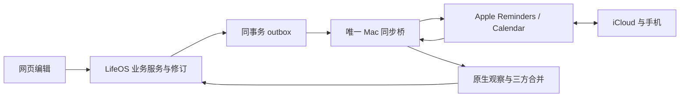

# Apple 双向同步：候选接口与启用边界

当前交付的是默认关闭、可注入合成适配器的源码候选。真实运行时没有设备鉴权实现、Apple 原生适配器、HTTP 客户端或后台调度；设置 `LIFEOS_APPLE_SYNC_CANDIDATE=source-v1` 也不会单独启用它。生产数据库、手机往返、真实权限和用户体验尚未验收。

## 数据怎样来回走

LifeOS 服务端是业务主库；网页和 Apple 都能产生编辑。Mac 桥主动连接服务端，不要求服务器连接 Mac，也没有新增 Mac 公网监听端口。

网站修改先经现有业务服务保存修订、历史、outbox 和命令回执；不在 API 中另建一套业务 CRUD。Apple 编辑以完整身份和字段观察回传，与共同基线、当前主库作三方比较。单端变化可接收，不同字段可合并；同字段、未知字段、身份或不支持的操作保留证据和冲突，不按设备时间强行覆盖。

读取不到字段用 `{kind:"unavailable",reason:"…"}`；明确没有值用 `{kind:"known",value:null}`。二者不能互换。原生本地 ID、外部 ID、来源和清单/日历共同参与身份；重复实例保留系列及原始 occurrence 身份。完整扫描只能产生待核对的缺失候选，本候选不执行原生删除，也不因找不到记录自动重建。

## 一次可靠的出站投递

1. `pull` 只返回队首元数据与投递状态，没有可执行意图。`prepare` 在服务端事务内从**当前主库**冻结完整投递，并先持久化后回复。outbox cursor 与主库 revision 是不同的量。
2. Mac 先把不可变投递和稳定 claim 请求写入私有 journal，再申请 claim；完整 claim 回执落盘后，重复核对原生快照、当前服务端授权和原有 Apple writer 门禁。
3. 原生保存前先落盘 `applying`，适配器须在真正保存前重复所有门禁、核对原生前置快照并保留未变字段。Mac 锁不能锁住手机编辑，真实适配器的并发边界仍需单独资格验证。
4. 保存后严格回读。只有完整身份、字段和语义哈希一致才能生成服务端 receipt；Mac 把 receipt 持久化后，才用固定 ACK 请求推进 cursor 和共同基线。ACK 不覆盖之后产生的主库修订。
5. 请求丢回复时重放同一命令。历史 reply 是结果，不是新保存许可；`authorize-save` 每次重新验证当前 claim、lease fence 和独立写许可。已进入 `applying` 或结果未知的 create 只能定位/回读，不能再创建。

尚未 claimed 的投递如遇原生变化，可以用精确版本 CAS 撤回，并在同一事务合并完整观察；合并成功后另建新 attempt。claim 与撤回竞争只允许一方成功。已经 claimed 的前置条件变化或 fence 不确定会阻断；本阶段不宣称它们能自动恢复。不同 bridge/identity epoch 不会因租约过期或投递终结而自动接管。

## Skills 与客户端的接口合同

所有操作均为 `POST /api/platform/personal/apple-sync/<operation>`，要求 `Content-Type: application/json` 和合法 `Idempotency-Key`。仅接受既定 origin/host、无 query 的准确路径；拒绝 cookie、重复 JSON key、未知字段、无效 UTF-8、超过 128 KiB 的请求和过深 JSON。响应带 `private, no-store`。关闭时返回 `503 / SYNC_UNAVAILABLE`。

设备身份必须由独立获准的 trusted verifier 注入 `ownerId / spaceId / bridgeId / identityEpoch / scopes`，不从请求正文或浏览器 session 提取。所有操作要求 `sync:read`；除 `capabilities / preview / pull` 外还要求 `sync:write` 和独立业务写许可。lease 自身无需已有 fence，其余有状态请求须携当前 fence。下面的键是精确集合：

| 操作 | JSON body 键 | 含义 |
|---|---|---|
| `capabilities` | 无，使用 `{}` | 返回候选协议、操作及已支持/未支持字段 |
| `lease` | `ttlSeconds` | 5–300 秒，同一绑定续租；不是设备注册 |
| `pull` | `fence, after, limit` | `after` 必须等于已确认 cursor；本阶段最多返回一个队首 |
| `preview` / `observation` | `fence, kind, mappingId, entityId, sourceId, expectedRevision, identity, fields, capabilities` | 预演或通过现有业务服务处理入站观察 |
| `prepare` | `fence, cursor, expectedDeliveryVersion` | 冻结当前主库；只有首次版本为 `null` |
| `claim` | `fence, attemptId, intentHash, expectedDeliveryVersion` | 精确认领，不自动接管旧执行权限 |
| `authorize-save` | `fence, attemptId, intentHash, claimId, claimVersion, executionFence` | 每次 fresh 核验，禁止命令缓存回复代替授权 |
| `retire` | `fence, attemptId, intentHash, expectedDeliveryVersion, observation` | 仅未 claimed，observation 包含 `identity, fields, capabilities` |
| `receipt` | `fence, attemptId, intentHash, expectedDeliveryVersion, claimId, proof, capabilities` | 验证精确原生回读，不接受客户端自报完成 |
| `ack` | `fence, receiptKey, attemptId, acknowledgement` | 自有固定命令 key，确认 receipt 后推进队首 |

cursor、fence 和 delivery version 是有界十进制**字符串**，不能转成 JavaScript Number。投递完整类型见 [store-contracts.ts](../src/apple-sync-candidate/store-contracts.ts)，原生观察见 [contracts.ts](../src/apple-sync-candidate/contracts.ts)，本机端口见 [bridge.ts](../src/apple-sync-candidate/bridge.ts)。调用端应保留完整不可变 reply，不从摘要重建可执行意图。

可信 transport 每次注入当前 fence；fence 不属于不可变请求内容的幂等摘要。命令身份仍绑定 owner、space、bridge 和 epoch。Skills 可读取 `capabilities` 决定是否支持某个操作，但这里没有通用 SQL、远程命令执行、动态下载 Skill、自动发放设备权限或传送凭据的接口。

## 已实现范围与未完成范围

候选业务映射仅有：todo 的 `title / notes / dueOn / status`（日期无值或日粒度，状态 open/done）；普通 planned calendar 的 `title / notes / schedule / status`。网站更丰富状态、带时刻的提醒日期、闹钟、循环及实例例外、取消、邀请和删除均不能靠当前映射完整往返；发现不支持的值会保留证据/冲突。完整原生适配仍是 OpenSpec 4.2，不以有接口名替代实现。

现有 CLI/Skill 字段覆盖与许可比较见 [工具研究](research/apple-native-tools-2026-11-03.md)。研究没有安装或启用新工具；换一个封装现有 CLI 的 Skill 不会恢复 CLI 未返回的字段。将来复用代码须保留其实际 LICENSE、版权及固定来源。

源码候选已用合成原生端口和真实业务 service 联测原始旧快照回退问题、独立字段合并、重复/丢回复、claim/retire 竞争、旧 fence、未知 create、不写原生的 no-op、receipt→ACK 顺序和后续修订。内存 outbox 是手工合成，不能证明真实 PG capture；默认跳过的 PG、真实断电、跨进程/设备、原生字段和生产检查均不是通过。

## 启用前必须另行完成

在获准的隔离环境执行真实 PostgreSQL/HTTP 资格与固定 SHA CI；完整原生适配及字段能力验证；注册具有限定 scope 的具体设备身份；核准真实 schema/GRANT、首次数据白名单和备份/隔离恢复；交接原有唯一 Apple writer；按需单独核准后台生命周期。journal 是 0700 目录/0600 文件；旧候选 v1 journal 会拒绝读取，不原地迁移、删除或覆盖。

提议 SQL 只能用于受控 setup，不在 startup/API 自动执行。其 readiness 摘要由受控迁移对实际约束生成；PG 升级或逻辑恢复后的目录重解析可能使检查保守拒绝，必须另行受控重新资格验证，运行时不自动改摘要或修表。

最后实测网页→Apple→手机修改/完成→网站刷新及重登一致、零重复/回环、离线重放、冲突/删除/重新打开、时区/DST/循环例外和隔离恢复；生产通过既有受控发布路径读回运行版本，用户体验单独验收。当前文档不授权这些真实操作。
