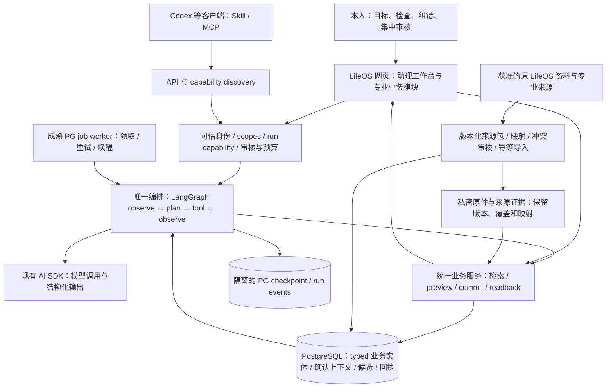

# LifeOS PersonalAgent 顶层设计

2026-11-05；统一实施设计。独立 builder 已确认无关键规划缺口；普通功能在需求入池后按持续授权自主实现、测试、独立评审和分阶段交付，owner 可随时纠正方向。真实权限、迁移、模型出站、费用和后台设置仍使用具体固定包授权。本文描述目标与工程合同，不是安装、测试、启用或本人验收的证明。

PersonalAgent 的目标是理解本人全部**已授权**资料、目标和偏好，持续提出有依据的整理与改善建议，让本人在一个网页中检查、纠错、审核并看到真实结果。推荐用 LangGraph 统一控制流程，PostgreSQL 保存证据、业务事实和可恢复状态，成熟 worker 推进长任务；既有业务服务统一承接网页、API、Skill 与 MCP。原 LifeOS 资料库按来源与类型迁入，而非整库投喂模型。每版交付能操作的实际网页及真实数据核验路径；未授权来源、未知覆盖和未完成门禁始终可见。

## 1. 目标、追踪与明确边界

- **用户已明确的产品要求**：整体 Agent 优先于零散功能；可检查全部授权资料、目标与偏好；自动提出分类、关联、疑重合并候选及主动洞察；集中审核；每阶段实际网页可操作并持续讨论；同一 LifeOS Key 按业务 scope 扩展；API/discovery/Skill/MCP 共享能力；原私有资料迁入 typed 数据库。
- **已批准的 A**：project/domain/topic API、网页显式 scope、discovery/Skill、原子分类 preview/commit。A 是整体架构的工具/审核层，按整体依赖进入实施，不再逐个内部接口等待本人确认。真实 SQL、现 Key 扩权和批量真实写仍需固定包与精确清单确认。
- 全部需求沿 [唯一基线](2026-11-04-requirements-intake.md) 的 34 个稳定 ID 追加细化；本图与阶段不是第二个 backlog。原 [unified-business-ui 五项](../../../openspec/changes/unified-business-ui/tasks.md) 继续保留 2/5 继承状态及渲染、性能、交付、本人验收门禁；既有 UI 的 CI 与发布验真由其原执行链收口，不由本稿关闭。

| 本设计部分 | 原 ID / 执行 Issue |
| --- | --- |
| Agent、可携带入口、模型边界 | LO-AGENT-001 #35；LO-AI-001 #19 |
| 分类、组织、审核闭环 | LO-TASK-001 #5；LO-PROJECT-001 #7；LO-CAPTURE-001 #18 |
| 原资料迁移、来源与搜索 | LO-DATA-001 #10；LO-SOURCE-001 #4；LO-SEARCH-001 #9 |
| 日记、日历、健康、财务、人物 | LO-JOURNAL-001 #6；LO-SCHEDULE-001 #12；LO-HEALTH-001 #15；LO-FIN-001 #11；LO-PEOPLE-001 #32 |
| 关系、工作台、洞察与输出 | LO-LINK-001 #33；LO-GRAPH-001 #34；LO-OVERVIEW-001 #14；LO-REPORT-001 / LO-OUTPUT-001 #17 |
| 身份、隐私与独立恢复 | LO-AUTH-001/002、LO-SEC-001、LO-PRIVACY-001 #3；LO-BACKUP-001 #20；LO-OPS-001 |

其他业务系统仅供通用架构类比，不读取公司资料或接入公司系统。已暂停的工作流保留暂停边界；本次迁移是独立任务。没有授权的新来源、新 scope、真实模型出站、付费、机器/后台服务设置和生产操作不得由总目标推导执行。

## 2. 当前事实与可复用基础

本节核对当前 owning source，表示源码能力，不表示生产部署、真实数据覆盖或本人验收：

| 源码事实 | 复用与缺口 |
| --- | --- |
| `personal-candidate/business.ts` / `service.ts` | todo/journal/project/domain/topic 封闭类型、owner/space、sourceId/revision 引用、单条 CAS/history/幂等回执；没有批量原子分类或通用合并 |
| `platform/postgres.ts` | transaction-local owner、受限角色核验、FORCE RLS、命令/记录锁；完整当前快照超过 10000 条失败，现有字符串搜索不是全文/语义检索 |
| `agent-api/capabilities.ts` | 真实 registry 目前只有 todo:read/write；不能宣称组织、健康、财务、全系统权限已存在 |
| `platform/ai-settings-contract.ts` / `ark-capture.ts` | 现有 AI SDK 7.0.150、Zod、受控 Ark 出站、超时/abort、结构化校验、遥测关闭；dataScope 仍只允许 current-message-only，月预算字段尚非硬限额 |
| 既有 intake / import-preview / capture-runs | 可复用来源摘要、状态与回执模式；旧导入是 synthetic 预览，不能改旗标当真实迁移；无完整 PersonalAgent 持久编排 |

保留既有 PersonalService、受限 PG、ReUI/Radix 和同源身份边界；只在明确缺口增加薄适配。现有锁序风险按 A1 的统一受影响记录顺序修复，不扩成全平台事务重写。

## 3. “了解我”的数据模型：证据与判断分开

| 层 | 最小合同与用户检查方式 |
| --- | --- |
| SourceEvidence | source/record identity、源 revision、发生/采集时间与精度、原件私密引用、摘要、授权与覆盖、mapper/schema 版本；打开来源可核对，原文不被 AI 摘要覆盖 |
| ConfirmedContext | 本人确认的事实、目标、偏好、约束；确认者/时间、有效区间、依据、被替代版本；可纠错、停用，不能从反复聊天自动升级为事实 |
| Inference | 模型分类/关联/疑重判断及理由、证据引用、未知项、模型/提示/检索版本；始终标 AI 推断，自报置信度不当作概率保证 |
| ActionProposal | 封闭 operation、before→after、源/目标版本、影响与可撤回性、选中项、完整 digest、到期时间；审核的是固定差异，编辑后产生新版本 |
| Run / Receipt | run/command、阶段、真实工具结果、审批、执行回执、读回及成本；checkpoint 是执行状态，不能当已确认记忆或业务事实 |

覆盖清单逐来源记录 authorized/connected、范围与排除项、lastReadAt/asOf、完整/部分/未知、截断/失败及下次可核动作。联网可用不等于历史迁入；源最新不等于目标最新。系统只能说“已覆盖这些授权范围”。
lineage 贯穿 `owner+space / sourceRefs+revisions / coverage / goal+preference revisions / producer grant revision / model+config revision / prompt+schema+mapper versions / proposal revision+digest / reviewer decision / receipt refs`；来源变化会使受影响推断和报告标记过期，保留旧依据供追溯。

## 4. 原 LifeOS 资料库迁移：保留原件，建立 typed 业务投影

只读 inventory 已核验原私有资料来源；公开/可分享设计不复制其路径、SHA、个人正文或秘密。可迁类别包括画像、领域/项目/专题、待办快照、日记原文、输入反思、训练/健康/财务/时间历史表格、报告规则及附件引用；清单仅说明存在，不是已导入或已授权逐条处理。

1. **固定来源包**：在获准目录只读生成不可变 manifest，记录包 digest、源身份/版本/大小、类别、时间与覆盖、私密原件引用；明确排除凭据、运行配置、cookie、工作流代码及公司材料。规则可作为待确认偏好来源，代码/命令不是个人已完成事实。
2. **封闭 mapping 与预览**：映射到 typed 实体/关系及 source item version；无法确定的字段进入 rejected/unknown，不补造时间、金额、完成状态或人物关系。旧快照、计划、待同步命令、回执、报告摘要分别保留类型，不能重放为当前操作或重复实绩。
3. **重复与冲突**：以稳定源 identity、规范引用、版本与内容 digest 判重；同身份不同内容是新版本/冲突，不靠同标题或 last-write-wins 合并。跨源疑重只出候选并列字段、原件、冲突、引用影响；未批准不删原件、不跨 authority 覆盖。
4. **审核后 apply**：固定批次、目标 owner/space、mapping 版本、选中项与 digest，单 writer、幂等 command、目标 CAS 与事务回执；同 key 同内容重放恢复原结果，不同内容拒绝。跨批以 watermark/映射表接续；只有目标逐项读回对账后推进水位，失败先读回，不重新猜测执行。
5. **对账与保留**：逐项核身份/值/关系/状态及 accepted/rejected/duplicate/no-op 总量，网页能从业务实体回到私密来源；文件数不当记录数，相同 blob 不证明无语义重复。保留原件、导入映射和回执；源删除先 tombstone 审查，不删目标。回滚按批次精确逆向/CAS与引用依赖执行，数据库整库覆盖不是默认回滚。

公共 intake v2 只负责 source_batch/item_version/command 与覆盖；日历、训练 session/exercise/set、心率、身体测量、饮食、财务交易/账户/余额等使用专用列、枚举、单位与 CHECK。经验证原始证据和有限上游复杂结构可保留 JSON，禁止任意 derived JSON/自由公式表格代替业务语义。附件先索引引用；已盘点的 LFS pointer/size metadata 不证明附件可恢复，复制/下载/上传另按获准范围。
专业来源继续保留现有 authority：Apple 日期/时区语义、训记真实组次与训练截断、钱迹退款/转账/还款及余额对账；缺 export/coverage 不能宣称全量。已退休的时间账本保持历史只读，本迁移不恢复自动写入。

## 5. 编排选型与模型、工具、循环的关系

**建议主方案 C：LangGraph JS 唯一编排 + PG checkpointer + Graphile Worker 优先的成熟 PG job worker；现有 AI SDK 仅作模型客户端。** 模型理解上下文并提出下一步；工具是封闭业务能力；Skill 是使用方法；MCP 是协议适配；权限、事实和执行裁决归确定性服务。

| 比较路线 | 取舍与决定 |
| --- | --- |
| A：AI SDK Core + 自建状态机 | 窄分类闭环复用最多；完整目标的分支、耐久恢复与多审核点会逐步自建工作流引擎，不作为长期编排路线 |
| B：WorkflowAgent + Workflow 5 + PG World | 有效耐久方案；[官方 PG World](https://workflow-sdk.dev/worlds/postgres) 仍标 reference implementation，新增 Next 集成/内部路由防护与运行时；保留备选，不与 C 双跑 |
| C：LangGraph + PG + worker | 显式节点、分支、interrupt、回放适合多业务；增加隔离与运维工作，但复用现有 PG/Node 自托管，不强制新云、Redis 或 LangSmith |

graph node 内复用 `generateText + Output.object + Zod`、guarded fetch、abort 和脱敏；不再启动 ToolLoopAgent、WorkflowAgent 或第二个 createAgent loop。模型无自由 SQL、shell、URL、凭据与任意写工具。结构化 schema 只保证形状，事实与权限继续验证。
官方 [persistence](https://docs.langchain.com/oss/javascript/langgraph/persistence) 与 [interrupt](https://docs.langchain.com/oss/javascript/langgraph/interrupts) 提供状态/暂停恢复；节点恢复可能重跑，副作用仍须幂等。checkpointer 不领取后台任务；[Graphile Worker](https://worker.graphile.org/docs) 是至少一次投递的执行队列，负责唤醒/串行/重试，不成为第二个 Agent 编排器。
研究固定候选：[langgraph 1.6.1](https://registry.npmjs.org/@langchain%2flanggraph/1.6.1)、core 1.3.4、checkpoint 1.2.2、[PG saver 1.1.2](https://registry.npmjs.org/@langchain%2flanggraph-checkpoint-postgres/1.1.2)、[graphile-worker 0.18.0](https://registry.npmjs.org/graphile-worker/0.18.0)；可选 react 1.2.10 / sdk 1.12.10。Node24/Next16.4.1/React19.3/TS6.0.2/PG17.11 的声明范围核对不等于集成通过；最终单 npm lock、传递依赖许可/漏洞与真实构建/PG qualification 尚未完成。
官方前端建议评估 [@langchain/react](https://docs.langchain.com/oss/javascript/langchain/frontend/overview) 自有后端 adapter；保留 LifeOS 组件。已 archived 的 [agent-chat-ui](https://github.com/langchain-ai/agent-chat-ui) 仅参考；不引入 TS peer 冲突的 Node/Agent Server 包，不默认采用需许可/出站核定的托管产品。

## 6. 一次运行与质量学习怎样闭环

建议状态：`queued → observing → planning → proposing → awaiting-review → committing → verifying → completed`；另有 `paused / rejected / cancelled / conflict / budget-exhausted / failed / outcome-unknown`，每种都有下一步与可恢复条件。
observe 从授权 API/SQL 取最少相关证据与覆盖；plan 只生成有界步骤；tool 经服务端校验执行；再次 observe 核工具返回与新事实。达成明确验收即停，缺证据/授权/审核即等待；禁止为“持续聪明”无限自循环。
run 固定目标/来源/授权/模型配置版本及预算，展示真实阶段、证据计数、待审项与花费，不展示模型内部思维或虚构进度百分比。首次默认上限**建议**为每 run 20 个节点、6 次模型调用、20 次读/preview 工具、10 分钟活动执行；实际费用上限由固定包给出，未配置即禁止真实模型调用。
预算服务在调用前原子预留 worst-case 费用/额度，事后结算；供应商计量未知保守占用并标 unknown。SDK 不自动重试模型，graph/worker 共用一个 retry ledger；外部应答丢失不假定未计费、不叠加三层重试。
worker payload 仅 runId/commandId，租约与每 run 串行 fence 防竞争；通过 checkpoint 与业务 receipt 共同恢复。等待审核时持久化并结束 job，审批/新证据后再显式入队；关闭网页不等于取消，取消后不再发新调用，已发生副作用靠回执核清。
冲突要求新 preview/新审批，拒绝保存原因并结束该候选，结果未知先查询原 command receipt；不得换幂等键盲重试。回放/分支只重算候选，不能重放已提交写入；升级 graph schema 必须测试旧 checkpoint 可读/迁移或安全暂停。
**质量学习循环**是“运行与本人纠正 → 版本化评估集 → 比较提示/分类规则/检索 → 回归 → 受控替换”。更正先影响当前候选；只有本人确认才进入长期偏好，不能从一次拒绝泛化人格，也不自动改权限、提示或模型。
其他业务系统可借鉴的模式是“缺陷/报告证据→分类与风险候选→负责人审核→业务写入→回读→评估”；API+薄 MCP 也复用相同职责分工。本设计不读取公司资料，不作供应商法律可用性结论。

## 7. 身份、授权与审核：三个可信 actor

`TrustedActor` 只能由服务器构造：owner-session 来自当前 owner/MFA/同源会话；agent-grant 来自已验证 grant 与 binding；run-capability 来自已批准 run 的窄服务端委托。模型、浏览器 body、MCP 参数都不能选择 owner、scope、actor 或 SQL。
run-capability 绑定 owner/space、producer 身份与授权 revision、允许 operation/source 集、run/command、模型出站配置、预算与到期；checkpoint/job 不保存 bearer/cookie/secret。每次工具调用重验 capability、producer 当前状态与模块 readiness；撤销/缩 scope/失效立即阻止下一操作，不能由旧 checkpoint 续权。owner-origin 委托绑定发起会话的非秘密引用，会话失效则暂停并由本人重新认证续接同 run；Agent-origin 每步重验原 grant。
**本版安全选择**：后台委托只允许授权读取、推断和 preview；owner-only approve 只能由网页当前 MFA 会话完成，网页可串行 approve→commit。Agent API commit 仍可用于已获同 plan/digest owner approval 的精确动作，并重验 producer grant fence；后台 worker 无 commit 能力。无人值守业务写入是未来独立能力，不由运行 worker 自动获得。
A2 采纳双 actor：Agent 产生的 plan 绑定 producer grant；本人网页可审核同 owner/space plan，owner 原生 plan 的 grantId=null。owner 审批不修改 grant、不绕过 producer 撤销；Agent 无 approve operation。内部 run actor 不可强转 owner-session/AgentGrant，需窄 RunAuthority 证明后才进允许的 read/preview seam。
权限进一步区分：分类preview只需todo:read+organization:read，不预先要求todo:write；APIcommit才需todo:write+固定owner approval。owner网页commit使用本人自身写权限，但同事务重验producer原preview/read scopes仍有效，不伪造producer写scope，不将只读Agent升级为writer。后台委托仍不能commit；owner-origin独立plan无producergrant。通用fence命名assert_business_grant，允许明列read集合，含write时继续要求对应read。
审批存服务端独立 receipt：绑定 proposal revision、完整 delta digest、selected operation IDs、全部 source/target revisions、producer 与 policy revision、到期。编辑任一项即重审；普通 `confirmed:true`/模型 tool approval/浏览器 approved 标志不是授权证明。
一个 LifeOS Key 可通过 owner/MFA 的 CAS setScopes 保持字节不变、精确扩业务 scope；所有持有方会共享新权限，网页必须明示。scope 不延期、不改 owner、不自动扩权；read/write 分域，write 依赖相应 read；新增领域逐片显式批准。
网页只持当前会话，不持 LifeOS API key；key 管理继续独立 issuer。operation registry 同时投影 API/discovery、Skill 和 MCP：只宣告 implemented ∩ enabled ∩ readiness ∩ 当前授权，不能靠下载 Skill 获权。兼容选择：原 `/v1/capabilities` 继续要求 todo:read，仅投影原六个 operation，原 scope 字段和值保持不变；可增 requiredScopes 但不改变旧授权语义。新增 `/v2/capabilities` 返回 apiVersion=2 的 catalog，所有有效同 owner/space grant可调用，含 organization-only；requiredScopes 数组决定权限，业务路径仍按目录明列的 `/v1/...` 调用，不生成不存在的 v2 业务路由。新 Skill 优先v2，只有404可回退已知todo v1；授权失败不得回退绕过。
MCP 优先本机 stdio 固定 adapter，经**获准**凭据 runtime 调固定 HTTPS 业务 API；Skill/可分享配置不含账号、key、私有路径或个人记录。候选采用官方 split SDK server/client 2.4.0、协议 2026-07-28；需固定 lock/NOTICE 并测实际 host 兼容，不盲装旧单包。
远程 Streamable HTTP/OAuth 是后续固定身份方案：audience/resource/scope、PKCE 与 discovery 明确后实施；[HTTP authorization 与 stdio 的区别](https://modelcontextprotocol.io/specification/2026-07-28/basic/authorization) 不可混用。禁止 client token 透传到不匹配资源、直接 SQL 或 cookie/管理员旁路；API 与 MCP 同资源也需明示共同 audience/验证合同。

## 8. 原子提交、跨系统与恢复真实语义

库内分类复用 A 的不可变 plan/owner approval/batch receipt：1..100 项、30 分钟、128KiB 是**建议初值**；一个事务锁定并核全批记录、引用、before/CAS、scope、审批和 digest，任一失败整批业务/history/receipt 回滚。不能循环多个单条事务冒充原子。
锁顺序保持 owner maintenance → command → producer grant fence → plan → 统一 `(kind,id)` records → history/receipt；不同 command 同 plan 最多消费一次，全部 no-op 也有 batch receipt。同 key/同内容恢复原结果，同 key/不同内容 409；过期或后来编辑不否认已存在且仍有权读取的历史回执。
producer 撤销与已获锁提交串行：commit 先获 grant 锁可能完成，撤销先完成则后续拒绝；不承诺强行中断已取得授权锁的事务。网页提交后回读真实实体/关联版本及 receipt，不把 HTTP 200 当状态验真。
外部 Apple/训记/钱迹等不能加入本库事务：每步保留外部 command、回执、读回与前置条件，支持 partial/unknown/needs-repair；仅已有可逆 API 且逆向动作获准时补偿，不能宣称跨系统原子或自动撤销。迁移投影与上游回写分开，不默认双向同步。
当前 A 只改分类关系；真正 merge/split/delete/跨源写回需封闭字段保留/冲突/引用迁移/可恢复策略和固定清单，疑重候选不等于授权执行合并。

## 9. 私人存储、checkpoint 与运维门槛

业务/证据/候选/审核必须 owner+space 复合边界、受限角色和 FORCE RLS；checkpointer 的 thread_id 不构成鉴权。**设计选择**：独立 schema/角色与 run→owner/space 服务端绑定，所有 checkpoint list/get/delete/stream 经同一 guard；PG saver 的 RLS/owner context 不天然保证，未验证则该阶段 NO-GO，不以旁路超级用户运行。
checkpoint 尽量只存证据引用与必要的有界工作状态；原文进入状态即按私人数据处理。业务事实/长期确认上下文留在应用 typed 模型，不另建无审核长期 Store 形成第二份真相。保留/删除版本和受影响报告失效有审计；不能无限存全量消息/checkpoint。
默认关闭 LangSmith/云 trace/隐式环境 tracing，SDK 显式禁遥测；日志只保必要 operation/run/error/cost 元数据，禁 prompt、state、正文、key、cookie、原始 provider error。最终传递依赖需用 synthetic 出站断言核验，不把 core 默认等同整链零外发。
安全资格必须分别验证实际加密、密钥恢复、异地恢复、日志尺寸/数量限额及本机 pending command 保护；缺少实测的项目保持 unknown，不得写成全面安全已验收。
新增真实健康/财务/联系人或长期私人上下文前，固定包须提供存储与备份实际加密/密钥恢复边界、访问/保留元数据、日志限额及独立可丢弃目标的恢复演练；缺哪项只暂停依赖接入，不阻塞独立 UI/代码资格工作。
本机未知写入保持冻结原 command 的恢复能力；敏感接入前决定只存 command 引用/服务端草稿或经论证的本地保护、保留期限与安全退出，不以直接清空破坏幂等恢复。未知结果不能自动重发或恢复已暂停工作流。
新增数据库 schema/角色、worker 常驻、配置、网络、Keychain ACL、真实模型出站与费用均集中列入固定包；默认关闭、单 npm lock、固定依赖/制品，无新云服务。已有授权范围的代码交付继续，生产权限不由 public CI 承担。

## 10. 网页产品：助理工作台连接专业业务模块

助理工作台提供四个清晰入口：**待审核**（分类/关联/疑重/动作）、**了解我**（确认事实/目标/偏好与来源覆盖）、**运行进度**（当前阶段/等待原因/取消恢复/回执）、**洞察**（依据、影响、可选下一步）。首页突出当前一个重点，详情进入弹层/侧栏；大字、少重复入口，360px 起可用，明暗主题与键盘/focus/屏幕阅读器检查。
待审核可选批准/编辑/拒绝/稍后；批次先给影响摘要，再按需展开 before→after、原文、版本和引用。安全上不可拆的原子批次明确整体提交；部分选择产生新 proposal/digest，不沿用旧批准。冲突/unknown 留在原位置并给明确恢复操作。
“了解我”展示有效与已替代版本，允许本人改正并看影响；覆盖是来源状态，不显示伪造“理解完成度”。运行页断线可按 cursor 重新订阅、跨端读取同 run，禁止任意 checkpoint 回放触发写入；查看依据不暴露内部思维。
待办/项目、日记/人物、日历/纪念日、训练/身体/饮食、财务/账户继续专用模型与视图，通过引用、时间和来源连接；不做无边界自由表格/公式平台。专业详情与工作台打开同一实体，避免多套编辑器/writer。
每阶段 owner 看到实际部署 HTTPS 网页、真实已有记录或明确 not-connected 状态及可操作核验；synthetic 只供内部验证，不能替本人真实数据预览。授权未到位时交付可用的覆盖/授权界面并明确该阶段端到端验收未通过。

## 11. 检索、图关系与模型优化按评估演进

先用 scoped API、typed SQL/日期/引用遍历与受限搜索构造上下文；“全部理解”不等于每次把全部资料发给模型。中文/混合文本全文检索须真实评估，不能由 PG 原生能力直接推定召回达标。
语义 RAG 只在长文/改写召回不足有证据时引入：chunk 保留 owner/source/version/权限，embedding 出站纳入授权；先测 retrieval recall，再测回答有据性、过期数据与撤权过滤。图式检索先关系 SQL，确有多跳缺口再评估图存储。
LangGraph 是执行图，不是关系图谱。LO-GRAPH-001 的成熟 Gephi 路线保持独立 GPL/分发与隐私门槛，不能因本方案选 LangGraph 就替代其选型/验收，也不把推断关系画成已确认事实。
微调等到分类/行为稳定、获准高质纠正与留出集足够、prompt/context 改进仍不足才比较；不自动训练个人模型，不将所有私人资料当训练集。错误纠正与评估先带来可靠收益，再决定加库/换模型。

## 12. 整体里程碑：每版都有用户价值与网页验收

下表是原需求的依赖顺序，允许独立设计/测试并行；共享 schema/授权/来源 mapping 各有唯一 writer，先合并接口再集成。每版有同一真实站点的可操作页面、版本标识、已连接/未知来源和反馈入口，具体生产动作须匹配对应固定包批准。

| 版本 / 依赖 | 网页可用结果与真实数据验证路径 | GO / NO-GO |
| --- | --- | --- |
| V0 设计审阅 / 当前 | 本文总架构、边界/里程碑进入可阅读网页，持续讨论；原 UI 发布独立完成 | fresh builder 无关键规划缺口后按本人持续授权进入实现，过程反馈持续并入；不把文档页算 Agent 完成 |
| V1 可审整理 / A1+A2、身份与来源合同 | 组织/显式权限/固定 plan 分类审核，拿实际现有 todo 全覆盖→目录读回→preview→本人批准→原子提交→逐项回读；不增加后台或计划列表 | 无扩权旁路、PG 并发/撤销/幂等和真实 Chrome 通过；真实 SQL/scope/清单包未批则 NO-GO 真写 |
| V2 了解我与资料迁移 / intake v2、typed 与安全门槛 | 覆盖页、原资料可核对预览、确认目标/偏好；首个获准来源包从私密原件到 typed 实体/关系，网页逐条对账 | 身份/版本/覆盖对账、同包重复零新增、独立恢复通过；未知敏感保护/冲突未解不导入 |
| V3 可恢复助理 / V1、已获准的 V2 范围 | 助理工作台聚合候选/运行：实际读数据→自动候选→集中审核→结果；关闭网页/杀 worker/重启后继续同 run，用户能检查和取消 | TS6/Next/PG lock 资格、checkpoint隔离、重复投递零重复写、费用硬限额与出站边界通过；后台/费用包未批不启用 |
| V4 跨业务专业上下文 / V2 公共来源层 | 日记/人物、日历、训记、财务各自真实接入与专业页；同一目标跨业务查询有证据，缺失源明确显示 | 每域 operations/discovery/Skill/实际读回同片；精度/单位/退款/覆盖合格，一个源阻塞不伪造也不阻塞独立域 |
| V5 主动洞察与可携带入口 / V3、已验收领域 | 本人进入工作台或获准事件触发建议；纠错反馈可见；本机 MCP/Codex 用同 scope 查询/候选，关键指标与改进可比较 | 已批准触发/频率/来源/预算；MCP 实际 host 互通、权限一致、评估收益达标；远程 OAuth/无人值守写另包 |

每版共同验收：行为测试→typecheck/default-closed build与同制品检查→enabled 隔离 PG/真实 Chrome→独立安全/代码评审→固定 SHA CI→已获准固定制品交付→运行版本/主流程读回→本人体验；失败/skip/unavailable 单列，不推进原未通过门禁。
**建议初始质量线**：越权/撤销后新执行/重复副作用/审批错绑定均 0；100% 动作有可回读 receipt，100% 事实/建议有来源或明确未知；固定分类审查集目标≥95%精确率、疑重自动删除为0，召回/采纳率分别披露；性能先测基线和预先约定移动端/查询预算，不虚填完成值。
各版本 rollback 先关 flag/停止新 run/保留 in-flight 状态与回执，再回固定源码/lock/镜像；已写业务数据按精确 inverse/CAS，导入按批次依赖处理，scope 单独回退，checkpoint schema 不随镜像盲降级。无法无损回退的迁移必须预先演练并列 NO-GO。

## 13. 实施接口与职责：不再自建另一套业务后端

| 边界 | 应承接的结构化合同 / 明确职责 |
| --- | --- |
| ContextService / SourceCatalog | typed 查询、coverage/asOf、source refs、确认上下文版本、最少检索；无模型自由 SQL |
| IntakeService / domain mappers | manifest/mappingPreview/apply/readback、幂等与冲突、domain typed 投影；原件只读保留 |
| ProposalService / ReviewService | immutable proposal+digest、owner-only approve/reject、选中项重算、失效原因；A2 分类为第一个 adapter |
| BusinessService / Repository | actor/scopes/fence、封闭 operation、库内原子事务、CAS、history/receipt；所有入口共享同 writer |
| RunAuthority / BudgetService | 验证 actor/producer/run-capability、当前授权/出站/费用原子预留；不向 graph 返回 secret |
| Graph / RunService / worker | 图状态与版本、start/pause/cancel/resume/status/events、job串行/恢复；不是授权者或新业务事实库 |
| Web/API/MCP/Skill adapters | 同 registry/schemas/errors/coverage；网页会话、API grant、MCP transport 各验身份；Skill只教操作，不持凭据 |

API/stream DTO 只投影当前 actor 可见的证据、状态、候选与回执；分页、cursor、字段/记录上限和版本协商明确。网页 React adapter 对接研究是可移除适配，不为兼容官方 SDK 构建一个未授权 Agent Server。

## 14. 审阅结论与实施前未完成项

本稿的技术决定由执行者依据官方方案与现有约束选择，经独立 builder 检查后在已授权范围实施：采用 C 唯一编排；PG worker 优先 Graphile；owner-only approval、producer fence、后台只读/preview；事实/推断分离；迁移 source→typed；先 SQL/API 后按评估扩 RAG。已批准 A 的业务范围保留，未扩大其真实运行授权。
本设计已有独立 builder 无关键规划缺口的评审。正式规范与唯一新任务清单见 [personal-agent-foundation](../../../openspec/changes/personal-agent-foundation/proposal.md)，实施步骤见 [总计划](../plans/2026-11-05-personal-agent-foundation.md)。最终 lock/许可与TS6/Next/PG集成、run-capability/checkpointer restricted-role 实验、真实迁移mapping/固定包、加密恢复/日志/本机unknown策略、实际网页/模型/MCP/费用与本人验收仍需分别完成。本文不作测试、构建或生产通过结论。
执行顺序由新 OpenSpec 唯一任务清单与总计划确定，持续推进可用网页切片；owner 随时通过过程与实际结果纠正，不逐个内部接口重新索要方案确认。真实数据、扩权、后台与费用分别在准备好的固定包处确认。

## 15. 唯一身份与窄操作接口

`src/agent-authority/contracts.ts` 定义 server-only opaque branded TrustedActor：owner-session 带 ownerId/spaceId/sessionRef；agent-grant 带 ownerId/spaceId/grantId/scopes；run-capability 带 ownerId/spaceId/runId/capabilityRef。模型、HTTP body和MCP参数均不能铸造brand。AuthorityService复用现有owner/MFA与bearer验证器提供resolveOwnerActor/resolveAgentActor；运行阶段才提供resolveRunActor与每步assertCurrentAuthority。A2只做操作能力narrowing，不建立第二套actor权威。

RunAuthorityProof包含 runId/capabilityRef、producer、authorizationRevision、allowedOperationIds/sourceRefs、policyRevision/expiresAt；仅服务端短生命周期委托。producer为owner-session非秘密会话引用或agent-grant的grantId，不存cookie/bearer。checkpoint、job、event及公开DTO仅持引用。源权限与producer状态变化使下一步暂停；本人重新认证只能以新窄委托续接同run，不能从checkpoint恢复旧授权。

A1/A2精确文件、接口、RED-GREEN和PG/Chrome门禁分别见[组织与权限计划](../plans/2026-11-05-organization-access.md)及[原子分类计划](../plans/2026-11-05-atomic-classification.md)。新总change只追踪Agent新意图，原UI五任务、key management及operation旧change保留原状态；新版scope扩展保留既有expiry/replacement/验证约束，不把过去source测试当新运行验收。
